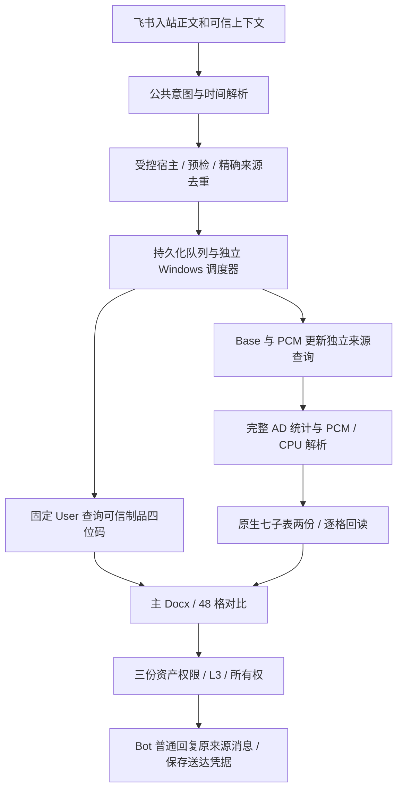

# 架构与数据流

## 模块职责

| 模块 | 职责 |
| --- | --- |
| `intent_router.py` / `natural_input.py` / `semantic_input.py` | 区分新业务、维护和追问；规范化输入并保存原文、时间锚点及变更依据 |
| `deployment/walkthrough_entry.py` | 固定解释器、安装清单、静态身份、启动预检及精确记录恢复 |
| `native_lifecycle.py` / `native_dispatcher.py` | 持久队列、跨进程锁、调度服务和受限并行 |
| `environment_selection.py` / `native_log_source.py` | 各窗 Prod→Test 来源选择、完整下载计划与来源证据 |
| `download_checkpoint.py` / `download_scheduler.py` | 逐文件完整性、下载预算、有限重试和仅限本任务的缓存复用 |
| `run_m100.py` / `native_execution_compat.py` | 调用获准完整分析器、Windows 原生执行隔离和统计契约 |
| `window_pipeline.py` / `cloud_pipeline.py` | 双窗阶段管理、PCM/CPU 与完整 AD 的重叠处理 |
| `native_sheet_data.py` / `native_sheet_delivery.py` | 七子表计划、模板绑定、写数和完整回读 |
| `product_version.py` / `feishu_report.py` / `report_policy.py` | 可信制品码、主报告、身份权限及一次性交付 |

## 数据和并行边界

每窗的四类 AD 来源为 `log_fsdA`、`log_fsdB`、`log_xcu_mcu`、`log_bzcu_eth`；PCM/CPU 使用 `log_fsdA_service`。AD 来源发现按原生契约向结束时刻扩展一小时，实际统计仍严格限制在用户窗口；PCM/CPU 使用请求窗口。任何查询异常不等价于“成功但无日志”。

完整规则每任务只读取一次并冻结，双窗共享指纹。两窗可来自不同环境，同窗来源不能混用。每窗最多四路下载，PCM 下载不叠加同窗 AD 下载池。原生解析每窗最多四个进程，双窗预算按可用逻辑核数限制；实际 spawn 审计须与请求一致。

任务键来自来源消息 ID 的摘要，同时绑定发送者、群、请求两窗、角色、执行版本、身份和分析配置。保存原始可信上下文；不跨来源、跨人或跨版本认领结果。

## 报告与身份

固定 User 用于完整规则、原模板只读及复制权核对、获准群的制品查询和必要密级操作。报告 Bot 创建、写入并治理主 Docx 与两份 Sheets。原共享模板保持只读；fixed_user 桥接模式必须存在真实复制回执、身份及完整等价验证的 ready 记录。

主报告保留缺失和未解析标记。无可信四位制品码不发布完整成功报告。三份资产逐份完成来源群查看、请求者所有权、Bot 管理权限、L3 及临时 User 权限回收后，普通回复原消息。仅有明确本来源送达回执才进入 `completed`。

更多契约见源码 `references/`；其中旧版本迁移描述只作历史说明，当前安装以仓库部署文档和实际清单为准。
